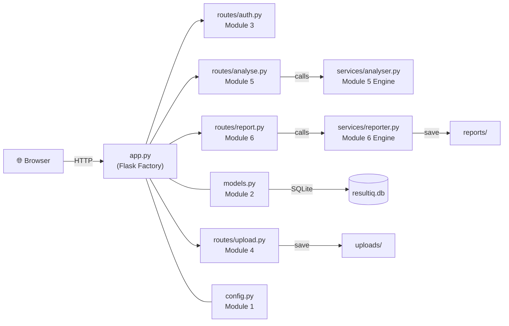
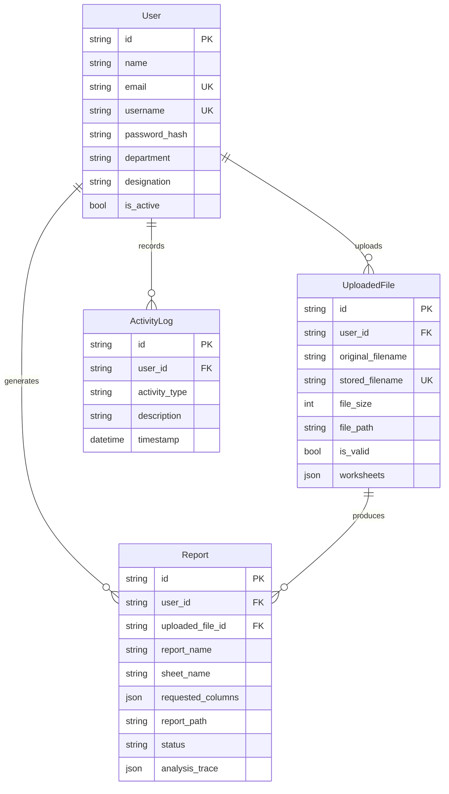
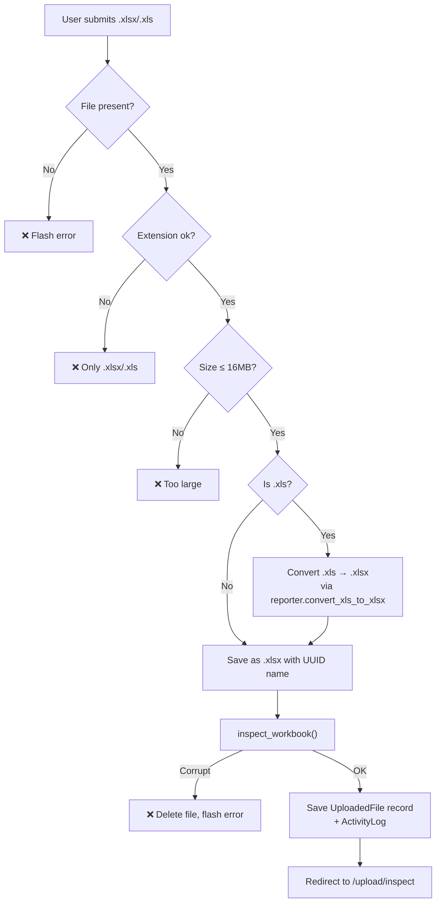
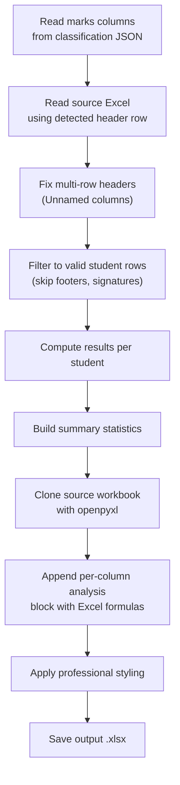
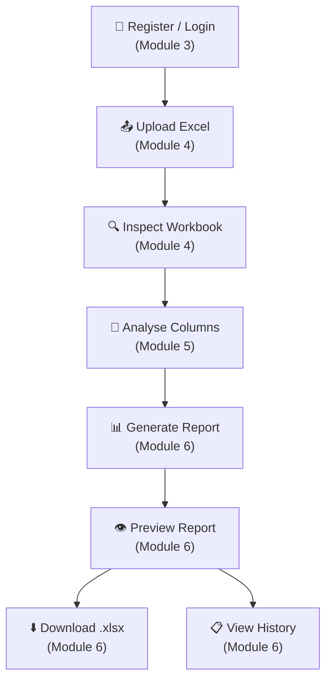

# ResultIQ — Complete Module Guide

> [!NOTE]
> ResultIQ is a **Flask web application** that lets teachers/faculty upload Excel mark sheets, automatically detect which columns contain student marks, and generate professional result-analysis reports — all without writing a single formula.

---

## High-Level Architecture

---

## Module-by-Module Breakdown

---

### 1️⃣ `config.py` — Application Configuration (Module 1)

**Purpose:** Central place for all configuration settings — no magic strings scattered across files.

| What it defines | Details |
|---|---|
| **Secret key** | For session signing (reads `SECRET_KEY` env var, falls back to a dev default) |
| **Session lifetime** | 30-day persistent sessions so users stay logged in |
| **Upload & Report folders** | `uploads/` and `reports/` directories, auto-created at startup |
| **Max upload size** | 16 MB cap to prevent oversized files |
| **Database URI** | SQLite file `resultiq.db` (or a `DATABASE_URL` env var for production) |
| **Config profiles** | `DevelopmentConfig` (debug on), `TestingConfig` (separate test DB), `ProductionConfig` |

**Key takeaway:** You pick a profile name (`'development'`, `'testing'`, `'production'`) and the app loads the matching settings automatically.

---

### 2️⃣ `models.py` — Database Models (Module 2)

**Purpose:** Defines the four SQLAlchemy ORM tables that store *everything* the app needs to remember.

| Model | Role |
|---|---|
| **User** | Stores credentials (hashed passwords via Werkzeug), profile info (name, email, department, designation). Supports Flask-Login for session management. |
| **UploadedFile** | One row per uploaded Excel file. The `worksheets` JSON column stores the full column-metadata inspection result (sheet names, column names, data types, samples, and later the classification results). |
| **Report** | One row per generated report. Tracks status (`pending` → `processing` → `completed` / `failed`), stores the path to the output `.xlsx`, and the `analysis_trace` JSON with pass/fail statistics. |
| **ActivityLog** | Audit trail — logs every significant action (`FILE_UPLOADED`, `FILE_ANALYSED`, `REPORT_GENERATED`) with timestamp. |

---

### 3️⃣ `app.py` — Application Factory (Wiring Module)

**Purpose:** The **entry point** that wires everything together using Flask's application factory pattern.

**What it does step by step:**

1. Creates a `Flask` app and loads config from `config.py`
2. Creates `uploads/` and `reports/` directories if missing
3. Initialises **SQLAlchemy** (database ORM) and **Flask-Login** (session auth)
4. Registers the `user_loader` callback so Flask-Login can look up users by ID
5. Adds a custom Jinja2 `enumerate` filter for templates
6. Imports and registers **4 Blueprints** — `auth_bp`, `upload_bp`, `analyse_bp`, `report_bp`
7. Defines the root route `/` → renders `index.html` (landing page)
8. Registers error handlers for **404** and **500**
9. When run directly (`python app.py`), creates all DB tables and starts the dev server

---

### 4️⃣ `routes/auth.py` — Authentication Routes (Module 3)

**Purpose:** Handles user registration, login, logout, and the dashboard.

| Route | Method | What it does |
|---|---|---|
| `/register` | GET/POST | Shows registration form. On POST: validates all fields, enforces **strong password rules** (≥8 chars, uppercase, lowercase, digit, special char, no spaces), checks for duplicate email/username, creates the user. |
| `/login` | GET/POST | Shows login form. Accepts **email or username**. Strips accidental trailing spaces from passwords. Sets a 30-day persistent session. Redirects to `?next=` URL if present. |
| `/logout` | GET | Clears session, logs out, redirects to home. |
| `/dashboard` | GET | Shows the user's dashboard with their **5 most recent reports**. |

**Security notes:**
- Passwords are stored as **Werkzeug hashed** values (never plaintext)
- Login gives distinct error messages for "account not found" vs "wrong password"
- All routes except `/register` and `/login` require `@login_required`

---

### 5️⃣ `routes/upload.py` — File Upload & Inspection (Module 4)

**Purpose:** Lets users upload `.xlsx` / `.xls` mark sheets and immediately inspects them.

| Route | Method | What it does |
|---|---|---|
| `/upload` | GET | Shows upload form + list of 5 recently uploaded files |
| `/upload` | POST | Receives the Excel file, validates it, saves it, inspects it, stores metadata |
| `/upload/inspect/<file_id>` | GET | Displays the inspection results (sheets, columns, data types, samples) |

**Upload pipeline (POST):**

**`inspect_workbook()` function:**
- Opens the Excel file with pandas (`openpyxl` for `.xlsx`, `xlrd` for `.xls`)
- For each worksheet: reads columns, infers data types (Integer, Decimal, Text, Date/Time, Boolean), grabs 3 sample values
- Skips unnamed/empty columns
- Returns a clean JSON structure stored in `UploadedFile.worksheets`

---

### 6️⃣ `services/analyser.py` — Intelligent Column Classifier (Module 5 Engine)

**Purpose:** The **brain** of ResultIQ. Automatically classifies every column in a mark sheet as one of: `marks`, `identity`, `metadata`, `category`, `empty`, or `text`.

> [!IMPORTANT]
> This module has **zero Flask imports** — it's pure Python + pandas, making it independently testable.

**Classification Logic (`classify_column`):**

The classifier uses a multi-step decision cascade:

| Step | Check | Example columns caught |
|---|---|---|
| 1 | **Datetime** type or name → `metadata` | `DOB`, `Timestamp` |
| 2 | **Identity name patterns** (regex) → `identity` | `Sl. No`, `Roll No`, `USN`, `Student Name`, `Email`, `Aadhaar` |
| 3 | **Excluded summary columns** (regex) → `metadata`/`category` | `Total Marks`, `Percentage`, `CGPA`, `Rank`, `Grade`, `Attendance`, `Result` |
| 4 | **Unnamed columns** → `metadata` | `Unnamed: 0` (from multi-row headers) |
| 5 | **Long names** (>40 chars) → `metadata` | Free-form description columns |
| 6 | **Nearly empty** (<5% filled) → `empty` | Placeholder columns |
| 7 | **Large numbers** (median >999) → `identity` | Registration numbers, phone numbers |
| 8 | **Rating/Likert guard** → `metadata` | Survey ratings 1–5, year columns |
| 9 | **Subject name match** + numeric data → `marks` | `Mathematics`, `Physics`, `24CS301`, `CIT-1`, `Quiz-2` |
| 10 | **Content-driven**: ≥50% numeric, ≥75% coverage, median ≤200 → `marks` | Unnamed but clearly numeric score columns |
| 11 | **High uniqueness** non-numeric → `identity` | Student IDs with unique text |
| 12 | **Low cardinality** text → `category` | Section (A/B/C), Gender |
| 13 | **Default** → `text` | Everything else |

**Header detection (`_detect_header_row`):**
- Scans first 35 rows, scores each candidate based on keyword matches (`Name`, `Roll No`, `Marks`, subject codes) and whether the next row has data
- Picks the highest-scoring row as the real header — handles messy sheets with title rows, blank rows, or merged cells above the actual table

**Quality metrics (`_build_quality`):**
For every column, computes: total rows, filled count, missing count, numeric count, absent-token count, text count, unique values.

---

### 7️⃣ `routes/analyse.py` — Analysis Route (Module 5 Route)

**Purpose:** Thin route layer that triggers the analyser and persists results.

| Route | Method | What it does |
|---|---|---|
| `/analyse/<file_id>` | GET | Runs `analyse_workbook()` on the uploaded file, saves the enriched worksheets JSON back to the DB, renders the results page |

**Results page shows:**
- Classification badge for every column (marks / identity / metadata / category)
- Quality stats per column
- A count of how many `marks` columns were found
- A **"Generate Report"** button that posts to Module 6

---

### 8️⃣ `services/reporter.py` — Report Generation Engine (Module 6 Engine)

**Purpose:** Takes a classified mark sheet and produces a **professionally styled Excel report** with computed results and per-subject analysis.

> [!IMPORTANT]
> Also **zero Flask imports** — pure Python + pandas + openpyxl. Fully testable in isolation.

**What `generate_report()` does:**

**Computed columns added per student:**

| Column | Formula |
|---|---|
| Total Marks | Sum of all marks (absent → 0) |
| Subjects Appeared | Count of subjects with a valid mark |
| Average | Mean of appeared subjects' marks |
| Percentage | (Total / max possible) × 100 |
| Result | **PASS** if overall ≥40% AND every subject ≥50%; else **FAIL** |

**Per-subject analysis block** (appended below student data in Excel):

| Row label | What it shows |
|---|---|
| appeared | Students who took this subject |
| passed | Students who scored ≥50 in this subject |
| % passed | Pass percentage |
| below 50% | Count in score bracket |
| 50%–60% | Count in score bracket |
| 61%–70% | Count in score bracket |
| 71%–80% | Count in score bracket |
| 81%–90% | Count in score bracket |
| 91%–100% | Count in score bracket |

**Styling features:**
- Grey header row with bold Arial font
- Thick borders throughout
- **Red highlight** (pink fill + dark red font) for marks < 50
- **Grey highlight** for absent students (`AA`, `Abs`, etc.)
- Native Excel conditional formatting rules (work when user opens the file)
- Proper column widths for names vs marks vs serial numbers
- Monkeypatched openpyxl writer to output cached formula values in `<v>` tags (so tools that don't evaluate formulas can still see the numbers)

**Absent token handling:**
Recognises 20+ absent markers: `AA`, `Ab`, `Abs`, `Absent`, `NA`, `N/A`, `-`, `--`, `Nil`, `None`, `Withheld`, `Medical`, `Detained`, `Exempted`, `OD`, etc.

---

### 9️⃣ `routes/report.py` — Report Routes (Module 6 Routes)

**Purpose:** Handles report generation, preview, download, and history.

| Route | Method | What it does |
|---|---|---|
| `/report/generate` | POST | Validates inputs, creates a `Report` record (status=`processing`), calls `generate_report()`, updates status to `completed` or `failed`, redirects to preview |
| `/report/<report_id>` | GET | Reads the generated `.xlsx`, displays a data table preview with summary stats in the browser |
| `/report/<report_id>/download` | GET | Streams the `.xlsx` file as a download, records the download timestamp |
| `/reports` | GET | Lists all reports for the current user, ordered by most recent first |

**Preview page displays:**
- Pass/fail statistics, percentages, student counts
- A full HTML data table with all rows from the generated report
- Download button

---

### 🔟 Templates & Static Assets

| Path | Purpose |
|---|---|
| `templates/base.html` | Base layout with navigation, flash messages, Bootstrap |
| `templates/index.html` | Landing/home page |
| `templates/dashboard.html` | User dashboard with recent reports |
| `templates/auth/login.html` | Login form |
| `templates/auth/register.html` | Registration form |
| `templates/upload/index.html` | File upload form + recent uploads list |
| `templates/upload/inspect.html` | Workbook inspection results (sheets, columns, samples) |
| `templates/analyse/results.html` | Column classification results + Generate Report button |
| `templates/report/preview.html` | Report preview with stats + data table + download |
| `templates/report/history.html` | All past reports for the user |
| `templates/404.html` | Not Found error page |
| `templates/500.html` | Internal Server Error page |
| `static/css/style.css` | Custom CSS styles |
| `static/js/main.js` | Minimal JS foundation (just a DOMContentLoaded log) |

---

## End-to-End User Flow

1. **Register/Login** → Create an account or sign in
2. **Upload** → Drop an `.xlsx` / `.xls` mark sheet
3. **Inspect** → See all sheets, columns, data types, and sample values
4. **Analyse** → AI-powered classifier tags each column (marks / identity / metadata / category)
5. **Generate** → Engine computes Total, Average, Percentage, Pass/Fail per student + per-subject analysis
6. **Preview** → See the full results table in-browser with statistics
7. **Download** → Get a professionally styled Excel file with formulas, conditional formatting, and analysis block

---

## Tech Stack

| Layer | Technology |
|---|---|
| Backend | **Flask 3.0** (Python) |
| Database | **SQLite** via Flask-SQLAlchemy |
| Auth | **Flask-Login** + Werkzeug password hashing |
| Excel I/O | **pandas** + **openpyxl** (`.xlsx`) + **xlrd** (`.xls`) |
| Frontend | Jinja2 templates + Bootstrap + minimal custom JS |
| Config | Python classes + environment variables |
